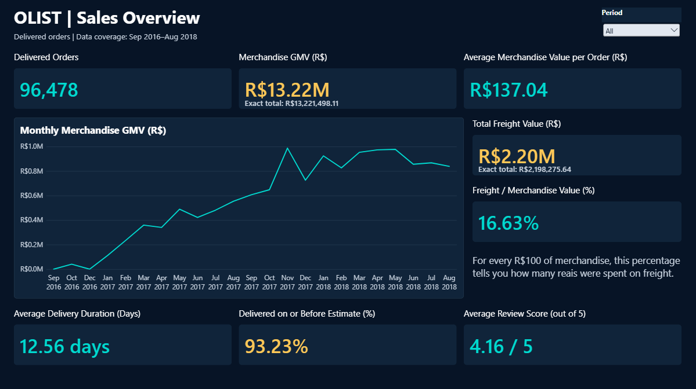
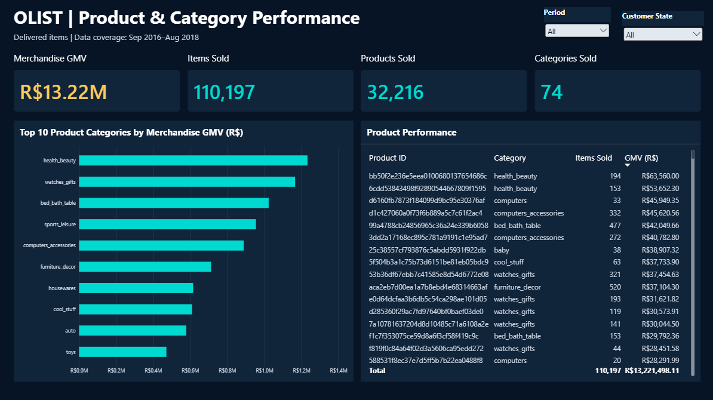
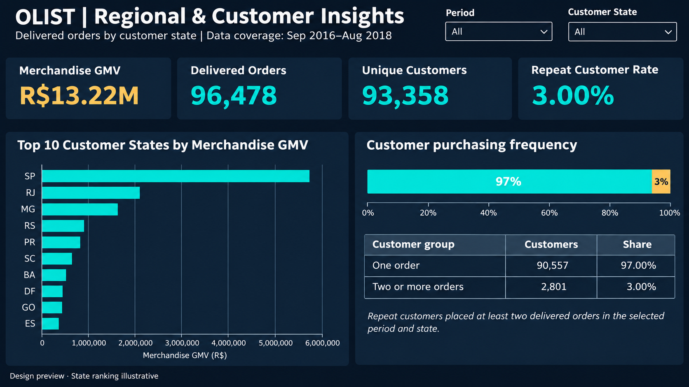
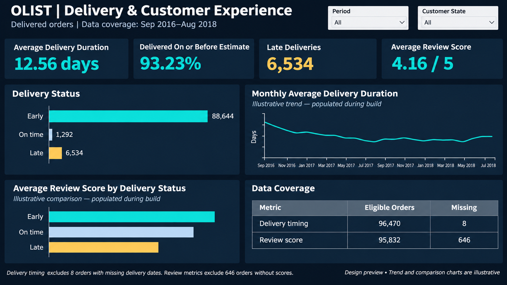
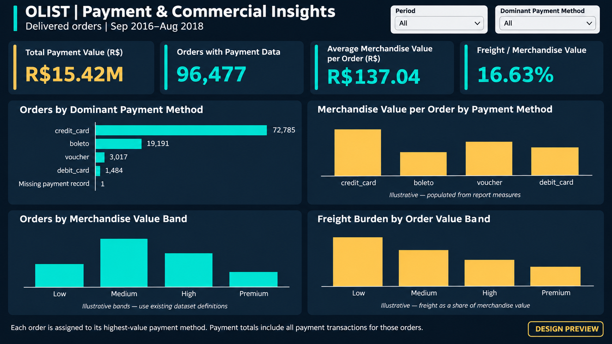

# Olist Brazilian E-Commerce Analytics

An end-to-end analytics project using Python, SQL Server, and Power BI to examine sales, product performance, customer purchasing behavior, delivery experience, and payment patterns.

The Power BI report covers delivered orders purchased from September 2016 through August 2018.

## 1. Business Objective

Turn transactional e-commerce data into consistent business metrics and an interactive report that answers:

- How does merchandise sales value change over time?
- Which products, categories, and customer states contribute the most merchandise value?
- How many customers place repeat orders within the selected period?
- How do review scores differ by delivery status?
- How do payment methods and order values relate to commercial performance?
- How large is freight value relative to merchandise value?

## 2. Dashboard Preview

**Power BI file:** [Olist_Analytics.pbix](dashboard/Olist_Analytics.pbix)

The report contains five presentation pages and a hidden Validation page used for internal checks.

## 3. Scope and Headline Results

Commercial reporting uses delivered orders. Full-source records are retained separately for data auditing and SQL import validation.

| Metric | Result |
|---|---:|
| Delivered orders | 96,478 |
| Items sold | 110,197 |
| Unique customers | 93,358 |
| Products sold | 32,216 |
| Categories sold | 74 |
| Merchandise GMV | R$13,221,498.11 |
| Total freight value | R$2,198,275.64 |
| Average merchandise value per order | R$137.04 |
| Freight / merchandise value | 16.63% |
| Orders with payment data | 96,477 |
| Total payment value | Approximately R$15.42 million |
| Average delivery duration | 12.56 days |
| Delivered on or before estimate | 93.23% |
| Late deliveries | 6,534 |
| Average review score | 4.16 / 5 |
| Repeat customer rate | 3.00% |

Results above represent the report with slicers set to All and chart selections cleared.

## 4. Key Findings

### 4.1 Sales and product performance

- Delivered orders generated R$13.22 million in merchandise GMV.
- Health and beauty, watches and gifts, and bed, bath and table were the leading categories by merchandise GMV.
- Merchandise GMV excludes freight and is distinct from total payment value.

### 4.2 Regional and customer behavior

- São Paulo was the leading customer state, contributing approximately R$5.07 million in merchandise GMV.
- Of 93,358 customers, 90,557 placed one delivered order and 2,801 placed at least two.
- The repeat customer rate was 3.00% within the selected analysis scope.

### 4.3 Delivery and customer experience

- 93.23% of orders with eligible delivery-status data arrived on or before their estimated delivery date.
- Average review scores were 4.29 for early deliveries, 4.04 for on-time deliveries, and 2.27 for late deliveries.
- Late delivery was associated with lower review scores. This descriptive comparison does not establish causation.

### 4.4 Payment and freight patterns

- Credit card was the dominant payment method for 72,785 delivered orders.
- Average merchandise value per order was R$143.24 for credit-card-dominant orders, compared with R$95.57 for voucher-dominant orders.
- Freight represented 48.19% of merchandise value in the R$0–50 order band, compared with 4.76% in the R$1,000+ band.

These findings support further investigation into late-delivery drivers, repeat purchasing, and freight affordability for lower-value orders. They do not demonstrate the impact of a business intervention.

## 5. Dashboard Pages

### Sales Overview

Sales totals, monthly merchandise GMV, freight value, delivery performance, and review scores.

### Product & Category Performance

Category ranking and product-level performance, with period and customer-state filters.

### Regional & Customer Insights

Customer-state performance and purchasing frequency within the selected period and state.

### Delivery & Customer Experience

Delivery status, monthly delivery duration, review scores, and metric-specific data coverage.

### Payment & Commercial Insights

Dominant payment methods, merchandise value bands, and freight-to-merchandise ratios.

## 6. Tools and Workflow

| Tool | Role |
|---|---|
| Python and pandas | Profiling, cleaning, transformations, analysis, and validation |
| Jupyter notebooks | Documented analysis and dataset preparation |
| SQL Server | Relational storage, constraints, and business analysis |
| SQL Server Management Studio | CSV import and SQL execution |
| Power Query | Import and preparation of reporting tables |
| Power BI and DAX | Semantic model, measures, filters, and interactive reporting |
| CSV and Parquet | Prepared datasets and analytical outputs |

Python prepares cleaned and analysis-ready datasets. SQL Server provides a relational analysis workflow using cleaned source tables. Power BI imports the prepared reporting CSVs; the dashboard does not require a live SQL Server connection.

## 7. Data Preparation and Quality Decisions

The workflow includes:

- Inspecting source structure, missing values, duplicates, and candidate keys.
- Converting timestamps and identifying lifecycle inconsistencies.
- Preserving identifiers and ZIP-code prefixes as text.
- Preparing order-level and item-level datasets at separate grains.
- Aggregating payment information to order level before combining it with order-level analysis.
- Assigning a dominant payment method based on the highest aggregated payment value per method within an order.
- Reconciling counts and monetary totals across preparation stages.
- Retaining exceptions while excluding them only from metrics that require unavailable data.

### Metric-specific coverage

| Metric area | Eligible orders | Missing orders |
|---|---:|---:|
| Delivery timing | 96,470 | 8 |
| Review score | 95,832 | 646 |
| Payment data | 96,477 | 1 |

Orders with missing delivery or review information remain in the delivered-order sales population.

The order without a payment record remains visible as “Missing payment record” in the payment-method analysis.

### Category exceptions

- 610 products have a missing source category.
- 13 products have a non-missing category without a matching English translation.
- Missing categories and untranslated categories are handled explicitly rather than silently dropped.

## 8. Power BI Model

The reporting model separates two fact-table grains:

| Table | Grain |
|---|---|
| fact_orders | One row per delivered order |
| fact_order_items | One row per delivered order item |

Dimensions include:

- dim_date
- dim_customer_state
- dim_customers
- dim_payment_method
- dim_products
- dim_sellers

Date, customer state, customer, and payment-method dimensions filter orders. Orders filter their associated items. Product and seller dimensions filter order items.

Relationships use single-direction filtering. Product and seller selections do not automatically filter the upstream order table.

Customer-state analysis uses the state recorded on each order.

## 9. Metric Definitions

| Metric | Definition |
|---|---|
| Delivered orders | Number of orders in the delivered-order fact table |
| Merchandise GMV | Sum of delivered item prices, excluding freight |
| Total freight | Sum of freight values for delivered items |
| Average merchandise value per order | Merchandise GMV divided by delivered orders |
| Freight / merchandise value | Total freight divided by merchandise GMV |
| Unique customers | Distinct customer_unique_id values in the selected order scope |
| Repeat customers | Customers with at least two delivered orders in the selected scope |
| Repeat customer rate | Repeat customers divided by unique customers |
| Average delivery duration | Average delivery_duration_days for eligible orders |
| Delivered on or before estimate | Eligible early or on-time orders divided by eligible delivery-status orders |
| Average review score | Average order-level review score for review-eligible orders |
| Orders with payment data | Delivered orders with a matched payment record |
| Total payment value | Sum of all payments associated with the selected orders |
| Dominant payment method | Method with the highest aggregated payment value within an order |

The freight ratio is a ratio of totals, not an unweighted average of individual order percentages.

Selecting a dominant payment method selects a group of orders. Total Payment Value still includes all payment transactions associated with those orders.

## 10. Project Organization

| Path | Contents |
|---|---|
| dashboard/ | Power BI report |
| data/raw/ | Original source CSV files |
| data/processed/ | Cleaned and analysis-ready datasets |
| data/processed/payment_and_commercial_analysis/ | Payment and commercial outputs |
| data/processed/powerbi/ | Power BI fact and dimension CSVs |
| notebooks/ | Nine numbered preparation and analysis notebooks |
| sql/ | SQL Server setup, validation, constraints, and analysis scripts |
| reports/tables/ | Exported analytical and reconciliation tables |
| reports/screenshots/ | Five dashboard screenshots |
| requirements.txt | Python dependency list |

### Notebook sequence

| Notebook | Purpose |
|---|---|
| 01_data_understanding.ipynb | Source exploration |
| 02_data_quality_audit.ipynb | Data-quality assessment |
| 03_data_cleaning_and_preparation.ipynb | Cleaning and preparation |
| 04_analysis_ready_dataset.ipynb | Analysis-ready dataset construction |
| 05_kpi_analysis_and_business_insights.ipynb | KPI, category, and product analysis |
| 06_regional_and_customer_analysis.ipynb | Regional performance and customer behavior |
| 07_payment_and_commercial_analysis.ipynb | Payment and commercial analysis |
| 08_sql_data_preparation.ipynb | SQL source profiling and preparation |
| 09_powerbi_data_preparation.ipynb | Power BI reporting-table preparation |

### SQL sequence

| Script or step | Purpose |
|---|---|
| 01_sqlserver_database_setup.sql | Database setup |
| SSMS Import Flat File wizard | Import the eight cleaned CSV files |
| 03_sqlserver_import_validation.sql | Validate imported records and structure |
| 04_sqlserver_database_constraints.sql | Apply and verify keys and constraints |
| 05_sqlserver_business_kpis.sql | Business KPI analysis |
| 06_sqlserver_category_product_analysis.sql | Category and product analysis |
| 07_sqlserver_regional_customer_analysis.sql | Regional and customer analysis |
| 08_sqlserver_delivery_review_analysis.sql | Delivery and review analysis |
| 09_sqlserver_payment_commercial_analysis.sql | Payment and commercial analysis |

There is no separate step-02 SQL script: table creation and population use the SSMS Import Flat File wizard.

See [SQL setup documentation](sql/README.md) for table mappings, expected row counts, data types, constraints, and import checks.

## 11. Running the Project

### Python preparation

1. Obtain the Olist source CSVs and place them in data/raw/.
2. Create and activate a Python virtual environment.
3. Install dependencies using `python -m pip install -r requirements.txt`.
4. Select that environment as the notebook kernel.
5. Run the numbered notebooks in sequence, reviewing validation outputs before continuing.

Notebook paths such as `../data/processed/` assume execution from the notebooks directory. Confirm the working directory before running cells.

### SQL Server analysis

1. Complete the cleaned-data preparation and SQL profiling notebook.
2. Run the database setup script.
3. Import the eight cleaned CSV files using the documented wizard workflow.
4. Run import validation.
5. Review the existing database state before running the constraint script.
6. Run business-analysis scripts 05–09.

The constraint creation statements are not intended for repeated execution against constraints that already exist.

### Power BI report

1. Complete the Power BI data-preparation notebook.
2. Open dashboard/Olist_Analytics.pbix in Power BI Desktop.
3. Update local CSV source paths to match your project location.
4. Refresh the report.
5. Compare the All-selection totals with the headline results above.

Reporting fact and dimension files are in data/processed/powerbi/. Summary outputs such as overall_kpi_summary.csv and monthly_kpi_summary.csv are in reports/tables/.

The saved report uses local file paths, so another machine will require source-path updates.

## 12. Validation

Checks performed during development include:

- Source and prepared row-count reconciliation.
- Candidate-key uniqueness and missing-key checks.
- SQL import validation for all eight cleaned source tables.
- Primary-key and foreign-key verification.
- Monetary reconciliation between Python and SQL for full-source imports.
- Delivered-order KPI comparisons across analytical outputs and Power BI.
- Period and customer-state slicer checks.
- Payment-method filtering checks.
- Delivery-status interaction checks, including percentage bounds.
- Restoration of baseline totals after clearing selections.

Full-source SQL import totals differ from delivered-only dashboard totals because they represent different populations.

## 13. Limitations

- Results describe a historical dataset covering September 2016 through August 2018.
- Delivered-only reporting excludes canceled, unavailable, and other undelivered orders from commercial KPIs.
- Merchandise GMV and payment value are not measures of Olist’s net revenue or profit.
- Missing delivery, review, and payment data create different eligible populations.
- Repeat purchasing is measured within the selected scope, not over an unrestricted customer lifetime.
- Dominant payment method summarizes orders that may contain multiple payment methods.
- Freight ratios describe recorded freight charges relative to merchandise value; they do not measure fulfillment profitability.
- Relationships between delivery, reviews, payment methods, and order values are descriptive, not causal.
- Small groups, including the single missing-payment order, should not be treated as reliable business segments.

## 14. Data Attribution

This project uses the Brazilian E-Commerce Public Dataset by Olist.

The original data belongs to its respective providers. This repository presents an independent portfolio analysis and is not an official Olist report.

## 15. Author

Yashwanth H J